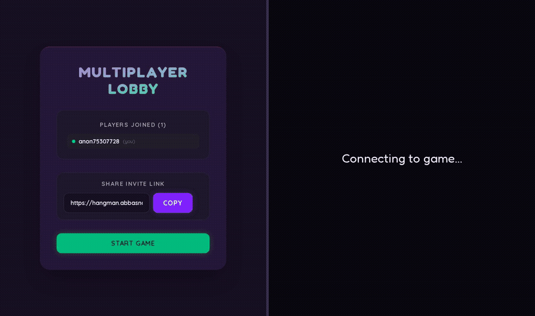
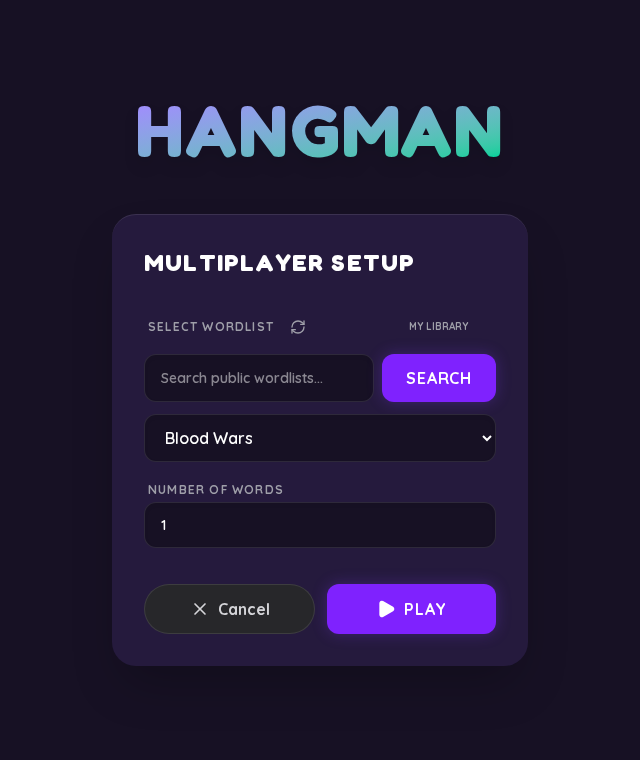
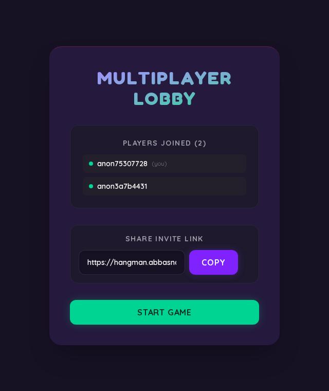

# Hangman V2

A remake of Hangman for the browser with real-time multiplayer: up to 50 players race to solve the same words in a shared room, over WebSockets. There is also a singleplayer mode, custom wordlists and a history of past games. It is a Next.js client and a Node.js server (Express for the REST API, Socket.IO for games), with Supabase for auth and the database.

Live at [hangman.abbasnadir.tech](https://hangman.abbasnadir.tech) (client on Vercel) with the API and sockets at [api.hangman.abbasnadir.tech](https://api.hangman.abbasnadir.tech) (Heroku).



*Two guest players in one multiplayer room, each in its own browser. The right-hand player opens the host's invite link and appears in the host's lobby; the host starts the game on both screens; the left-hand player solves the word first and sees the other player as "Playing..." until they finish, then both get the same round result. Recorded on the live site with two scripted guest accounts, shown at 1.5x speed.*

## Features

- **Sign in with Google or play as a guest.** Guests are Supabase anonymous users, so they can play straight away. Guests can't create or edit wordlists, change their profile or send friend requests (those routes are marked `non-guest` on the server).
- **Singleplayer** ("Play Online"): one player, five lives, a timer, and a keyboard you can click or type on.
- **Multiplayer for 2 to 50 players.** The host creates a room and shares its link. Players who open it appear in the lobby, and only the host can start. Everyone gets the same word; whoever solves it fastest wins the round and a point. With several words per game, the final leaderboard is sorted by points, then total time.
- **Several words per game** (1 to 10, chosen on the setup screen), played as rounds with a "Next Round" step in between.
- **Reconnecting.** A player who reloads or comes back to an unfinished game gets their lives, guesses and timer back. If everyone leaves, the game is marked abandoned after 10 seconds. Starting a new game while one is still active offers to rejoin or forfeit it, and the same account can't play one game in two tabs.
- **Wordlists.** Pick a default list or search public lists by name on the setup screen, or create your own (public or private) on the Wordlists page.
- **History.** The History page lists your past games with their words and results.

<p>
  
  
</p>

*The multiplayer setup screen and the host's lobby, captured on the live site as a guest.*

## How it works

**A game, end to end.** The client creates a game with `POST /game/create` (wordlist, mode, lives, number of words). The server checks the wordlist and mode, refuses if you're already in an active game, and inserts the game and its first round. The client then opens a Socket.IO connection, authenticated with the Supabase access token, and sends `game:join`. From there everything is a socket event: `game:start` (host only), `game:submit_move` for each letter, `game:start_next_round` and `game:leave`. The server answers the player who guessed and broadcasts joins, finishes, round results and the final leaderboard to the rest of the room.

**Game modes are classes.** `server/src/socket/game/core/CoreGameMode.ts` is an abstract class with the shared logic: joining and rejoining, applying a guess, deciding when a round ends, moving to the next word, and handling players who leave. Each mode fills in a few methods (`satisfies`, `evaluatePlayerResult`, `resetRound`, `getFinalResult`). `SinglePlayerMode` and `MultiplayerMode` sit in between: the multiplayer base adds lobby lists and broadcasts, and `modes/Multiplayer` adds scoring (first solver of a round gets a point). `modes/Classic` is the singleplayer mode. There is also an `InverseSinglePlayer` class, but the join handler only creates `Classic` (mode 1) or `Multiplayer` (mode 2) so far.

**State lives in memory, the database is written behind it.** Running games are kept in a map on the server (`game/core/registry.ts`). A guess is checked against that in-memory state and answered immediately; the database writes (moves, round results, finished games) go through a per-game queue so they stay in order without holding up the reply. The REST API and the socket server run in one Node process, so this design assumes a single server instance.

**Auth and limits.** Both the REST routes and the socket events verify the Supabase JWT against the project's JWKS (`server/src/shared/lib/verifyJwt.ts`). Each route or event declares its auth level (`none`, `optional`, `required`, `non-guest`), its rate limit and a Zod schema, and a small loader wires those up. REST limits use `express-rate-limit`; socket events use `rate-limiter-flexible`, per socket.

**Folders are split by transport.** `server/src/api/` holds only Express code, `server/src/socket/` only Socket.IO code, and `server/src/shared/` what both use (database queries, errors, JWT checks). On the client, `client/app/game/page.tsx` joins the game and picks `modes/ClassicGame.tsx` or `modes/MultiplayerGame.tsx`, which render the screens in `client/app/game/screens/`.

The REST API also has profile, profile search and friend request endpoints that the client doesn't use yet. The API design is in [design/api-design/](design/api-design/) and the database tables in [design/dbDesign.md](design/dbDesign.md).

## Tech stack

- **Client:** Next.js 16 (App Router), React 19, Tailwind CSS 4, Framer Motion, socket.io-client, supabase-js
- **Server:** Node.js, Express 4, Socket.IO 4, Zod 4, jose, express-rate-limit, rate-limiter-flexible
- **Database and auth:** Supabase (Postgres, Google OAuth and anonymous sign-in)
- **Hosting:** Vercel (client), Heroku (server, see `Procfile`)

## Run it locally

You need Node, pnpm and a Supabase project. The server only talks to Supabase, so there is nothing else to run.

**Supabase setup.** The repo has no SQL migrations, so the database has to be created by hand from [design/dbDesign.md](design/dbDesign.md). The code expects the tables there (`profiles`, `games`, `game_rounds`, `game_players`, `game_round_players`, `moves`, `game_modes`, `wordlists`, `relationships`), a `profiles_with_stats` view, `game_modes` rows with id 1 (singleplayer) and 2 (multiplayer), at least one wordlist with `default` and `is_public` set, and a `profile_pictures` storage bucket. Nothing in the server inserts into `profiles`, so a profile row for each new user has to be created on the database side. Turn on anonymous sign-ins for guests and the Google provider for "Login to Play".

**Server** (`server/.env`, see `server/.mockenv`):

| Variable | Purpose |
| --- | --- |
| `SUPABASE_URL` | Supabase project URL; also used to fetch the JWKS that verifies tokens |
| `SUPABASE_SERVICE_KEY` | Supabase service role key (server only) |
| `PORT` | Port for the API and sockets (default 5000) |
| `NODE_ENV` | `development` allows requests from `http://localhost:3000`; `production` allows `PROD_URL` |
| `PROD_URL` | The client's URL, required in production for CORS |

```bash
cd server
pnpm install
pnpm dev          # or: pnpm build && pnpm start
```

**Client** (`client/.env`, see `client/.mockenv`):

| Variable | Purpose |
| --- | --- |
| `NEXT_PUBLIC_SUPABASE_URL` | Supabase project URL |
| `NEXT_PUBLIC_SUPABASE_ANONKEY` | Supabase anon (public) key |
| `NEXT_PUBLIC_API_URL` | REST API base URL (default `http://localhost:5000`) |
| `NEXT_PUBLIC_SOCKET_URL` | Socket URL (default `ws://localhost:5000`) |

```bash
cd client
pnpm install
pnpm dev          # http://localhost:3000
```

There are no automated tests yet (`server/tests/` is empty).

What was checked for this README: the server builds with `pnpm build` and starts; `GET /` answers `{"message":"Works!"}`, `GET /me` without a token answers 401, and Socket.IO accepts connections. The client builds with `pnpm build`. Playing a game needs the Supabase schema above, which isn't in the repo, so the demos were recorded on the live site instead.

## Project structure

```text
client/
  app/
    page.tsx                 home: sign in, choose a mode, game setup
    game/page.tsx            joins the game over the socket and picks the mode
    game/modes/              ClassicGame and MultiplayerGame (state and socket events)
    game/screens/            Waiting (lobby), Playing and Ended screens
    wordlists/, logs/        wordlist editor and game history
  components/                keyboard, word tiles, header, UI kit
  hooks/useGameSocket.ts     socket actions and listeners for a game
  lib/                       Supabase client, REST helpers, socket service
server/src/
  server.ts                  one HTTP server for Express and Socket.IO
  api/                       REST routes, auth, rate limits, input checks
  socket/
    routes/                  game:join, start, submit_move, start_next_round, leave
    game/core/               CoreGameMode, SinglePlayerMode, MultiplayerMode, Player, registry
    game/modes/              Classic, Multiplayer, InverseSinglePlayer
    lib/                     socket auth, rate limits, router, disconnect handling
  shared/                    database queries, errors, JWT verification
design/                      API design, database design, user flow, constraints
```

## Credits

Built by Abbas Nadir (solo project).
